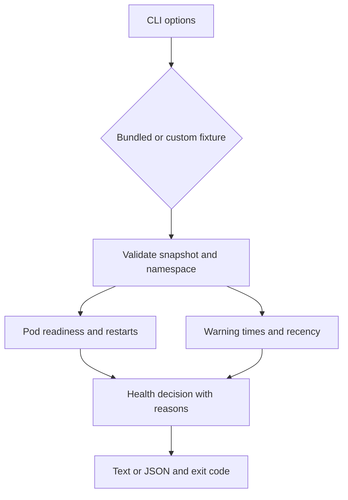

# Design

`health.analyze` is pure: it accepts a dictionary/options and returns a report without changing the input or contacting external services. `InputError` represents invalid structure or an unsupported option. `cli.main` handles files, package resources, flags and rendering. The bundled resources travel with the wheel; no cwd-relative resource path is used.

All timestamps are offset-aware and normalized to UTC. Event candidates are tried in documented order. Missing timestamps remain visible in diagnostics and produce UNKNOWN unless a known CRITICAL condition takes precedence. Completed Succeeded pods remain in detail output but are excluded from health readiness/restart counters. Known empty and unknown namespaces differ via fixture metadata.

Time/space complexity is linear in resources plus sorting of selected pod/event details: approximately O(P + E + p log p + e log e) time and O(P + E) space for validation and reports. This is a bounded educational snapshot analyzer, not a streaming metrics collector.

See README for the full policy and JSON schema. All algorithmic rules are explainable application choices. No claim is made that they equal a Kubernetes-defined namespace health standard.
